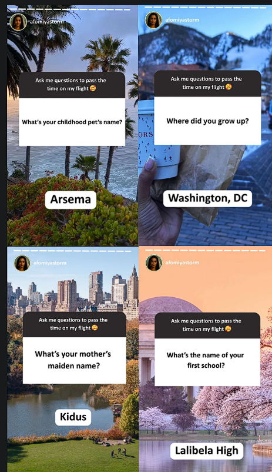
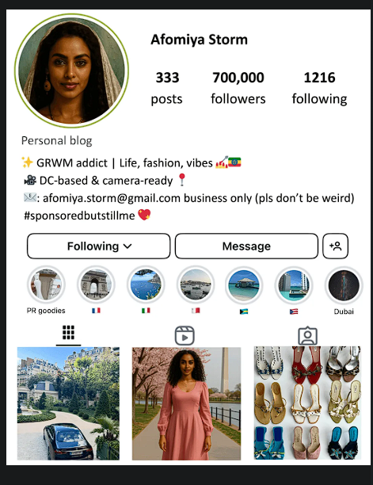
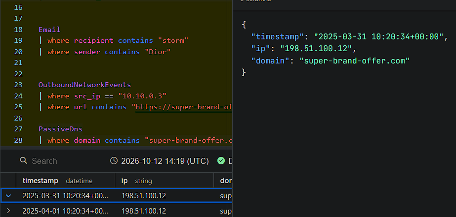
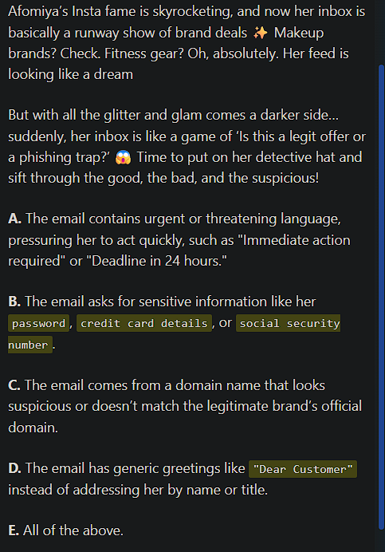
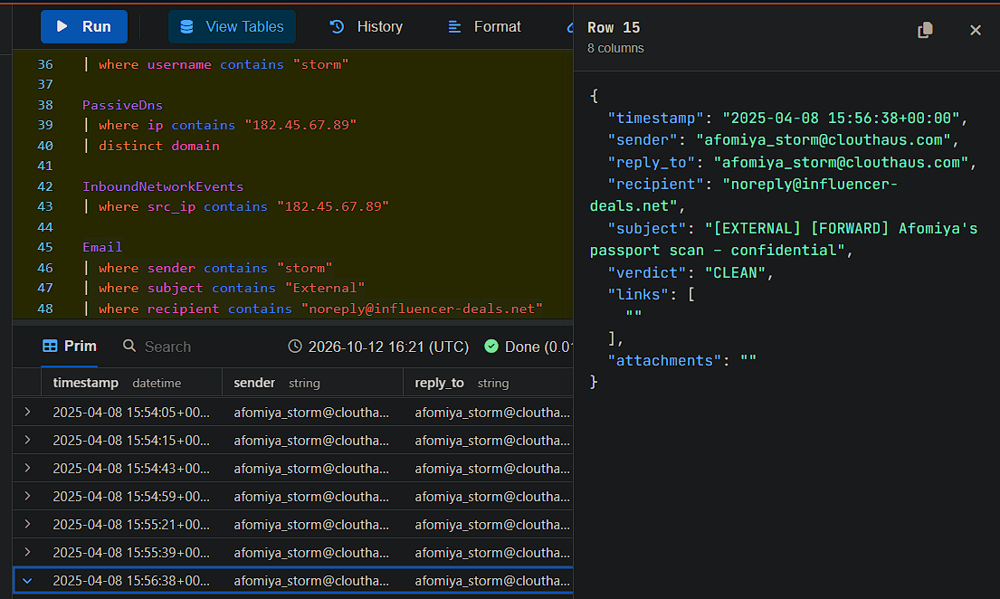
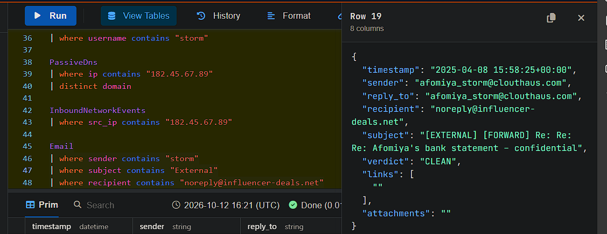
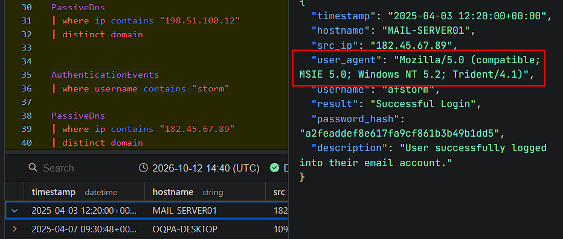
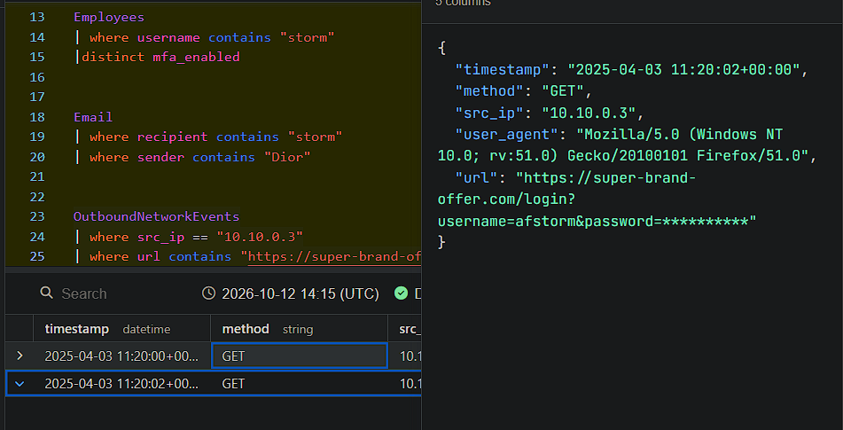
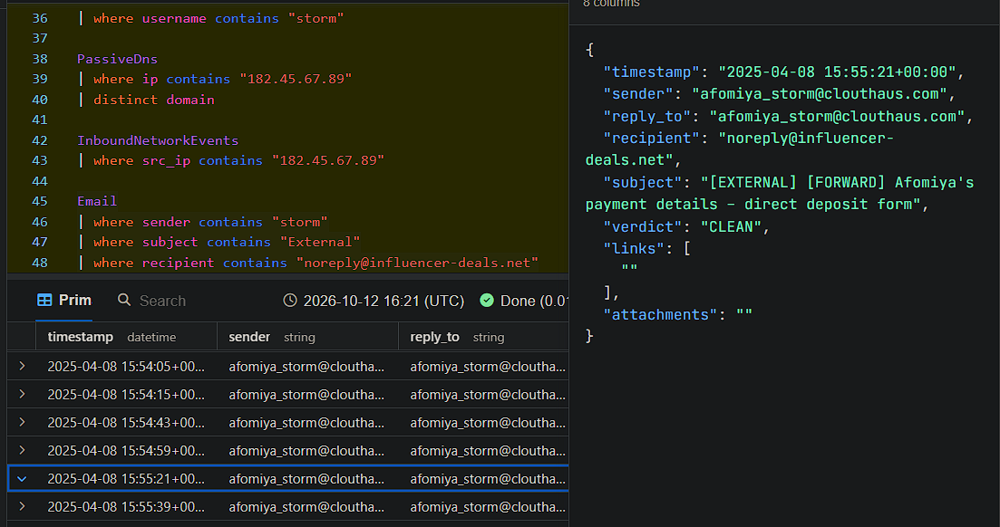

# KC7-CloutHaus

# KC7 CloutHaus Incident Write-Up: Afomiya Storm Compromise

## 1. Summary

A threat actor ran a multi-stage campaign against Afomiya Storm, an Influencer Partner at CloutHaus. They gathered personal details from her public Instagram, phished her work credentials with a fake Dior partnership email, and logged into her company mailbox one hour later. They then searched for her home address and ways to lure her, and sensitive documents were forwarded from her mailbox to an attacker-controlled domain.

Her personal accounts held up against the security-question attack because MFA blocked the password reset. Her CloutHaus work account did not have MFA (`mfa_enabled: False`), so the stolen password was enough.
**view [here](https://github.com/eth-hac-steven/KC7-CloutHaus/blob/main/unfiltered%20work.md) for full workings**

## 2. Key Indicators

| Indicator | Value |
|---|---|
| Victim | Afomiya Storm (`afstorm`), host `OQPA-DESKTOP`, IP `10.10.0.3` |
| Role | Influencer Partner |
| MFA status (work account) | `False` |
| Victim work email | `afomiya_storm@clouthaus.com` |
| Victim personal/business email (Instagram bio) | `afomiya.storm@gmail.com` |
| Phishing sender | `collabs@dior-partners.com` |
| Phishing subject | `[EXTERNAL] Exclusive Partnership Opportunity with Dior` |
| Phishing URL | `https://super-brand-offer.com/login` |
| Phishing infrastructure IP | `198.51.100.12` |
| Domains on `198.51.100.12` | `super-brand-offer.com`, `dior-partners.com`, `influencer-deals.net` (3 total) |
| Attacker login IP | `182.45.67.89` |
| Domains on `182.45.67.89` | `influencer-deals.net`, `dior-partners.com` |
| Attacker location | Jinan, Shandong, China (residential, AS4134, IRT-CHINANET-CN) |
| Attacker user agent | `Mozilla/5.0 (compatible; MSIE 5.0; Windows NT 5.2; Trident/4.1)` |
| Exfiltration destination | `noreply@influencer-deals.net` |

## 3. Timeline

| Time (UTC) | Event |
|---|---|
| 2025-03-31 10:20:34 | `super-brand-offer.com` first seen resolving to `198.51.100.12` |
| 2025-04-03 10:41:00 | Dior phishing email delivered (verdict `CLEAN`) |
| 2025-04-03 11:20:00 | Afomiya visits `https://super-brand-offer.com/login` |
| 2025-04-03 11:20:02 | Credentials submitted (`username=afstorm`) |
| 2025-04-03 12:20:00 | Attacker logs into `MAIL-SERVER01` as `afstorm` from `182.45.67.89` |
| 2025-04-04 12:48:29 | Attacker searches "How much would it cost to hire Afomiya for a fake birthday party?" |
| 2025-04-08 15:50 to 15:58 | Sensitive emails forwarded to `noreply@influencer-deals.net` |

## 4. Attack Chain

### 4.1 Reconnaissance (OSINT and social engineering)

Afomiya's public Instagram profile lists her business email and says she is DC-based.


*Evidence: Instagram profile screenshot (bio with `afomiya.storm@gmail.com`).*

During an Instagram Stories Q&A, followers asked questions that match common account security questions. Her answers were public:

| Question | Answer |
|---|---|
| Childhood pet's name | Arsema |
| Where did you grow up | Washington, DC |
| Mother's maiden name | Kidus |
| Name of first school | Lalibela High |



*Evidence: Q&A stories screenshot.*

The technique is **social engineering**, using **OSINT** (open source intelligence), which is the use of publicly available information to profile a target.

The attacker later submitted these answers on the authentication log (for example, "Kidus") to try to bypass the security questions.



The password reset still failed because a code was sent to Afomiya's phone. **2FA/MFA** is what protected her personal email account.

### 4.2 Infrastructure staging

Passive DNS shows `super-brand-offer.com` resolving to `198.51.100.12`, first seen on 2025-03-31.



Three distinct domains are linked to this IP.


### 4.3 Phishing delivery

On 2025-04-03 at 10:41:00, Afomiya received an email from `collabs@dior-partners.com` titled "[EXTERNAL] Exclusive Partnership Opportunity with Dior". It contained the link `https://super-brand-offer.com/login`. The email filter marked it `CLEAN`.


Indicators that should have flagged the email as phishing:

- Sender domain (`dior-partners.com`) does not match Dior's official domain
- Login link pointing to an unrelated domain (`super-brand-offer.com`)
- Unsolicited "exclusive" offer
- Request to log in with credentials

In the training question, the correct answer was **E (all of the above)**: urgent language, requests for sensitive information, a suspicious sender domain, and generic greetings.



### 4.4 Credential capture

Afomiya's workstation requested the phishing page at **2025-04-03 11:20:00**. Two seconds later, at **11:20:02**, her username and password were submitted to the site in the URL query string:

```
https://super-brand-offer.com/login?username=afstorm&password=**********
```





Her browser was also outdated (Firefox 51 on Windows NT 10.0).

### 4.5 Account takeover

Exactly one hour after she clicked the link, `afstorm` logged in to `MAIL-SERVER01` from `182.45.67.89` at **2025-04-03 12:20:00**. This was a different device, in a different country, using an obsolete Internet Explorer 5.0 / Windows NT 5.2 user agent. The Employees table shows `mfa_enabled: False`, so the stolen password was enough.







**IP lookup for `182.45.67.89`:**

| Field | Value |
|---|---|
| Location | Jinan, Shandong, China |
| ISP | IRT-CHINANET-CN |
| ASN | AS4134 |
| Network type | Residential |
| Coordinates | 36.6683, 116.9972 |


Passive DNS ties this IP to `influencer-deals.net` and `dior-partners.com`, linking the login to the same infrastructure used in the phishing email.


### 4.6 Stalking and targeting

Web search logs from the attacker IP on the CloutHaus search page show the attacker was interested in Afomiya's location and personal life:

| Search | What it shows |
|---|---|
| "Afomiya Storm home address (asking for a friend)" | Trying to find her **home address** / **location** |
| "What brand of leggings does Afomiya wear in her gym selfies" | Profiling her personal habits |
| "How much would it cost to hire Afomiya for a fake birthday party?" | A fake **birthday party** used as a lure |
| (Venmo-related search) | Targeting her **Venmo** account |




**Physical-world intel from social media:**

Afomiya's photos of her new apartment (pool and rooftop amenities) allowed the building to be identified by reverse image search as **The Apartments at CityCenter**. A close-up of her keys in her photo dump was an information leak that could allow the attacker to get into her mailbox.


### 4.7 Data exfiltration

On 2025-04-08, between about 15:50 and 15:58 UTC, emails were forwarded from Afomiya's mailbox to `noreply@influencer-deals.net`. All were marked `CLEAN`.

| Time (UTC) | Subject |
|---|---|
| 15:51:01 | [EXTERNAL] [FORWARD] Re: Invoice for recent sponsorship – payment details |
| 15:55:21 | [EXTERNAL] [FORWARD] Afomiya's payment details – direct deposit form |
| 15:56:38 | [EXTERNAL] [FORWARD] Afomiya's passport scan – confidential |
| 15:58:25 | [EXTERNAL] [FORWARD] Re: Re: Re: Afomiya's bank statement – confidential |
| (add timestamp) | [EXTERNAL] [FORWARD] Re: Tax documents – year-end summary |


### 4.8 Instagram hijack

Because Afomiya reused passwords, the attacker also gained access to her Instagram account. They messaged her followers asking for money and offering "exclusive investment opportunities". This was a **phishing scam**, not a legitimate deal.


## 5. Attacker Objective

The evidence points to a combination of goals:

- **Financial fraud and identity theft:** payment details, bank statement, tax documents, passport, Venmo
- **Physical stalking:** home address, apartment building, keys, fake birthday party lure
- **Monetizing her audience:** investment scam sent to her followers through the hijacked Instagram account

## 6. Findings and Control Gaps

1. **MFA was not enabled on the work account.** This turned a phished password into a full mailbox takeover.
2. **The email filter missed the phishing email.** It had a lookalike sender domain, an external login link, and a `CLEAN` verdict.
3. **Credentials were sent in the URL query string** to the phishing site.
4. **No alert on suspicious login.** A new country and an obsolete browser appeared one hour after the click.
5. **No data loss prevention on external forwards.** Passport, bank, and tax documents went to an external address with `CLEAN` verdicts.
6. **Password reuse** allowed the Instagram takeover.
7. **Oversharing on social media** (security question answers, apartment photos, keys) gave the attacker the material for recon.

## 7. Recommendations

1. Enforce MFA on all CloutHaus accounts, starting with external-facing roles.
2. Block `dior-partners.com`, `super-brand-offer.com`, and `influencer-deals.net`, and block IPs `198.51.100.12` and `182.45.67.89`.
3. Alert on logins from new countries and outdated user agents.
4. Block or review external forwarding of mail containing sensitive documents.
5. Run phishing awareness training for influencer and brand-facing staff.
6. Use a password manager and never reuse passwords across sites.
7. Do not answer security-question-style prompts publicly, and avoid posting photos that show keys, building views, or other identifying details.
8. Notify Afomiya of identity theft risk: replace her passport, set fraud alerts with her bank and tax authority, enable credit monitoring, and review her Venmo account.


